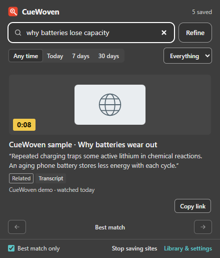

# CueWoven

**Find a video or page from the detail you remember.**

Describe a quote, idea, scene or passage. CueWoven searches a library saved in your browser and links back to a matching video moment or page.

CueWoven is a local-first extension for desktop Chrome and Microsoft Edge. No account or personal YouTube API key is required.

[Download](https://github.com/eric-chenCS/CueWoven/releases/latest) · [Installation guide](INSTALL.md) · [User guide](docs/USAGE.md) · [Privacy policy](docs/PRIVACY.md) · [Contributing](CONTRIBUTING.md)



*Extension UI with original sample content, without personal browsing history.*

## Install and try it

1. Use desktop Chrome or Microsoft Edge. Open the [latest release](https://github.com/eric-chenCS/CueWoven/releases/latest), expand **Assets** if needed, and download **`cuewoven-v<version>.zip`**. You do not need Node.js or pnpm for this download.
2. Extract the **entire ZIP** into a permanent folder. On Windows, use **Extract All** before proceeding. Keep `manifest.json` and the `vendor/` folder together; do not move only the manifest or open files inside the ZIP.
3. Open `chrome://extensions` or `edge://extensions`, enable **Developer mode**, and choose **Load unpacked**. Select the extracted folder that directly contains `manifest.json`; open an inner folder first if extraction created an extra outer folder.
4. Confirm CueWoven is enabled, then refresh any YouTube or website tabs that were already open. Open CueWoven from the toolbar and choose **Try sample videos**.
5. Wait for the search model to finish loading, search **“why do batteries wear out”**, then press **Enter** to show matches. Open a result to visit the matching moment.

The first use of a model requires an internet connection to download its files. Setup time depends on the connection and your computer.

Open the popup with **Ctrl+Shift+F** on Windows/Linux or **Command+Shift+K** on macOS. If the shortcut is unavailable, change it on your browser's extensions shortcuts page or use the toolbar icon.

The named release asset includes the browser runtime. **Code → Download ZIP**, **Source code (zip)** and **Source code (tar.gz)** do not include the generated `vendor/` files and need the build steps below. These instructions install an unpacked extension; they do not require a browser-store listing. If saving fails or you see **Failed to fetch dynamically imported module**, follow the [installation troubleshooting checks](INSTALL.md#if-something-does-not-work).

## Build your library

Watch YouTube videos as usual. YouTube is the only default capture site. After the watch delay, CueWoven attempts to save available captions and video information. When captions are unavailable, local English speech recognition starts automatically while you play the video. Missing or undetermined language metadata also allows an English attempt; known non-English audio is skipped. Control transcription under **Library & settings → Settings**, not in the search popup. Enabled visual features sample scenes and read on-screen text.

To save pages from other websites, choose sites during first-run setup or add them under **Library & settings → Websites**, grant browser access, and refresh already-open tabs. Website audio transcription and saving Google searches are off by default. Only compatible browser video players are supported; protected players may prevent capture.

Videos are saved as you watch them. The default watch delay is 10 seconds for longer videos and up to 5 seconds for short videos. The popup shows **Preparing searchable text…** while captions or initial player speech are processing. CueWoven does not scan previous browser visits, import Google Takeout files, or accept pasted video links for background transcript fetching. You can restore a library previously exported from CueWoven.

## Search what you remember

- **Words and ideas:** search captions, locally transcribed English speech, saved page passages and image captions.
- **Visual details:** search sampled video scenes, saved article images and recognized on-screen text.
- **Source and date:** narrow results with filters or phrases such as “last week”; search within the current YouTube video.
- **Follow a match:** open a timestamp or a page passage where supported, copy its link, or browse other matches with the arrow keys.
- **Refine a result:** add another detail when the first match is not the one you meant.

Press **Enter** to search after editing your query. Semantic search combines local embeddings with words, titles and context. Relevant text and speech matches take priority; scenes and saved images are searched as a fallback when no strong text match is found. Results are estimates, and a matching detail may be absent from the saved evidence. [How indexing and ranking work →](docs/ARCHITECTURE.md)

For weak, closely competing text results, CueWoven can ask a second local model, Ettin 32M q8, to check the order. Strong text matches and quoted searches keep the normal fast path. The extra model downloads about 37 MB once; downloads and loading run in the background, and a slow or unavailable reranker leaves the original results available. Saved text, embeddings and timestamps are preserved. [Selective reranking](docs/SELECTIVE-RERANKING.md)

## Privacy and controls

Your library and search index stay in the current browser profile. CueWoven does not send your queries, transcripts, captured audio or saved library to an AI service or the developer. Model files download from Hugging Face; normal website, caption, image and thumbnail requests still occur. Download services receive ordinary network connection information. CueWoven does not request browser-history permission.

Use settings to pause saving, exclude sites, choose retention and image-storage limits, delete items, or export and restore a backup. Incognito capture is excluded. Sensitive-page filters and shared text redaction (including recognizable API keys, tokens and private-key blocks) reduce unwanted capture but cannot detect every private page, and captured images are not redacted.

Available captions can cover more of a video than you have played. Speech, scene and on-screen-text capture depend on playback and cannot recover earlier audio or guarantee every brief scene. **Lite mode** keeps text capture while pausing new speech, scene, image and OCR capture. Local models use CPU, memory and disk space.

On first setup of the automatic Lite feature, devices reporting 8 GB of physical RAM or less start in Lite mode. You can turn it off in Settings; your choice survives restarts and updates. Resetting settings restores the device default. A local memory check uses the `system.memory` permission; it sends no hardware information to the developer. Lite mode reduces new media processing, but is not a fixed memory limit or a guarantee of smooth performance on every 8 GB laptop.

Backups contain saved evidence, not original video files or complete websites. Export a backup before uninstalling, clearing a browser profile or switching installation folders. Unpacked installations need manual updates; keep the same folder, reload the extension, and refresh open tabs. [Privacy policy](docs/PRIVACY.md) · [Data controls and backup limits](docs/USAGE.md#privacy-and-data)

## Build from source

Requires **Node.js 22+** and **pnpm 11.25.0**.

```sh
git clone https://github.com/eric-chenCS/CueWoven.git
cd CueWoven
pnpm install --frozen-lockfile --ignore-scripts
pnpm run vendor
pnpm test
```

Load the repository folder as an unpacked extension after building. The generated `vendor/` directory contains the bundled JavaScript, WebAssembly and OCR runtime. AI model weights download separately when needed.

For isolated browser regression checks, see [CONTRIBUTING.md](CONTRIBUTING.md). Unit tests and controlled browser fixtures help catch regressions; they do not guarantee live caption availability or retrieval accuracy on arbitrary websites.

## Package for distribution

After building and testing:

```sh
pnpm run zip
node scripts/zip.mjs --store
```

`cuewoven-v<version>.zip` includes the runtime, documentation and development files for a downloadable release. `cuewoven-store-v<version>.zip` contains the runtime files for a store submission. Rebuild both archives after changing files they contain.

The [store listing draft](docs/STORE-LISTING.md) and `docs/store/` assets support submission. Before uploading, verify that the privacy-policy URL is publicly accessible, disclosures match actual behavior, screenshots match the current UI, and the submitted archive passes browser checks. Store approval is determined by the store's review.
