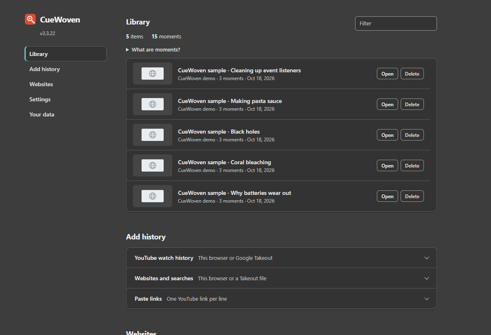

# Using CueWoven

[Install first](../INSTALL.md), then open the toolbar popup to search. Your library can start empty or with optional original sample videos.

*Sample content in an isolated browser profile.*

## Search what you remember

Describe an idea, phrase, image or scene, then press **Enter**. Typing alone does not run a search or show matches. Editing the query or refinement hides old matches until you submit again. Each search is independent; use **Refine** for extra clues. Source/date filters narrow the results. **Best match only** shows one source at a time; use ← and → for the next ranked match. Turn it off for a list. Results per video limits how many moments a video can occupy in that list; it does not limit the search to the first few videos.

A moment is a saved passage or observation at a video time. Indicators identify the evidence: Transcript, Audio, Scene, On-screen text, Article image, Image caption or Title. Title-only results open a source without claiming a matching spoken timestamp. Scores express ranking, not probability.

Press Enter once to search; press Enter again to open the shown result, or use **Copy link**. **Search this video** restricts search to the current YouTube video and tries indexing if needed. The `rc` address-bar keyword also searches your library.

## Choose what gets saved

Saving is enabled with YouTube as the only starter site. Add the other suggested sites or your own domains under Websites. Browser access is requested on a user click; already granted access may not show a new prompt. Refresh existing tabs afterward.

The × beside a site excludes future capture and imports while keeping saved items searchable. The popup's **Forget site** action deletes saved items for that site and blocks future capture. The site list and extra options can be collapsed. Broader public-website access is optional.

Allowed pages contribute up to 2,000 visible words and up to three accessible article images. Compatible visible video players can contribute native captions, played speech, scene snapshots and on-screen OCR. Website audio transcription is separately off by default. Native social-media apps, inaccessible frames, protected media and login walls are outside coverage. Feed URLs may reopen a feed rather than an exact clip.

Speech fallback is local and English-only. Known non-English or ambiguous mixed-language metadata skips automatic fallback; manual Start English transcription can override incorrect metadata. It processes only audio played after starting, one player at a time. Audio is not saved as a recording.

Visual capture samples frames; it does not continuously archive a video. Short events and small or stylized text may be missed. **Lite mode** pauses new article images, scenes, OCR and speech while keeping captions and article text. Settings also provide individual controls, light/dark/system appearance and **Reset settings to default**. Reset preserves the library, site choices and retention preferences.

## Bring your past history

Keep the settings page open until title import completes. Choose JSON when exporting from Google Takeout and extract the file first; HTML and ZIP archives are not accepted. JSON imports support files up to 100 MB.

| Source | What becomes searchable |
| --- | --- |
| YouTube `watch-history.json` | Video titles, channels and watch dates; optional available captions afterward |
| Chrome `BrowserHistory.json` | Page titles, URLs and visit dates |
| My Activity/Search JSON | Search text if enabled, and supported clicked-page titles |
| This browser's history | Saved visits in this browser profile after optional history permission |

Importing does not synchronize your Google account, prove a video was watched, fetch old article bodies, or recover past audio/scenes. Google-query saving is off by default for live capture and import; obvious medical queries remain excluded.

YouTube imports can fetch available transcripts for the newest 200 missing videos automatically. Use **Fetch missing transcripts** for more. A separate minimized window holds muted player tabs; it is visible in the taskbar and must remain open. Choose 1, 3, 6 or 10 parallel videos; fewer use less CPU/memory. Once title import finishes and fetching starts, settings can close, but the browser must stay open. Closing the capture window pauses new work. Failures leave titles searchable; retry after an interruption. Live watched-video capture can continue alongside the caption queue.

## Privacy and data

Your library, vectors and settings are stored in the current browser profile. Local models process search text, audio and images on your device. Model weights download from Hugging Face on first use; normal website/YouTube requests and thumbnails still use the network. No personal YouTube API key is required.

Site allowlists, exclusions, incognito avoidance, sensitive-route filtering and text redaction reduce unwanted capture. They cannot identify every signed-in/private page, and captured images are not redacted. Grant access only to sites you want to save; pause capture when appropriate. Diagnostics show approximate storage and a bounded session-only domain/reason log rather than full page content.

Under **Your data**, export/import backups, clear the library, or forget items saved recently. Backups contain your saved content: treat them as private and do not commit them to the repo. Keep settings open during restore; stop speech and pause transcript fetching before restoring. Completed batches remain if a restore is interrupted.

Retention choices are 24 hours, 7 days, 4 weeks, 12 months or Forever. Watched/read content uses the applicable recent capture/watch date. Imported history defaults to Forever; a finite imported-history period uses original visit dates. Watching an imported item makes normal live retention apply. **Forget recent** uses when CueWoven saved/updated an item, including recently imported entries with old visit dates. Export before deleting if you need a copy.

Visual storage is bounded to 240 MiB of accounted compressed-image/vector payload, up to 20,000 images overall and 240 per video; older visual evidence can be evicted. Full web content has a separate 2,000-item or 64 MiB accounted payload cap, with older items retained as titles. Models, browser storage overhead and other evidence use additional space. This is a searchable memory aid, not a complete archive.
